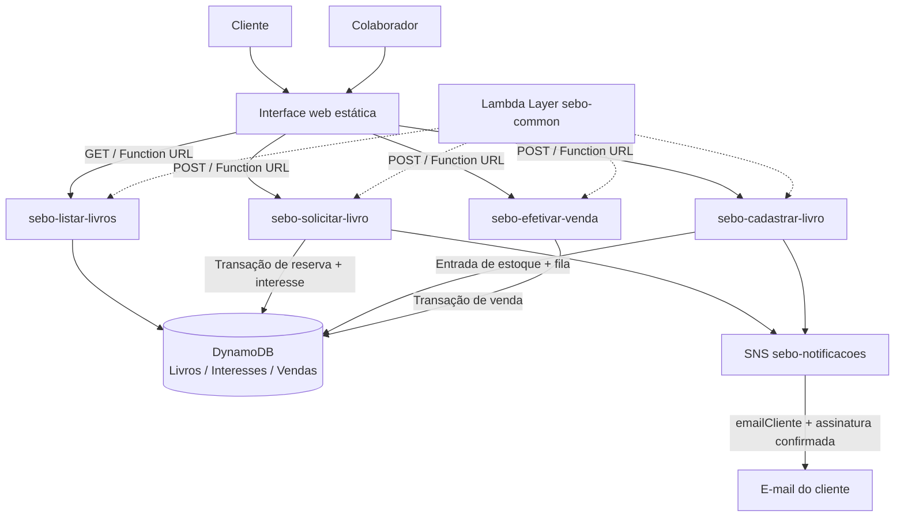
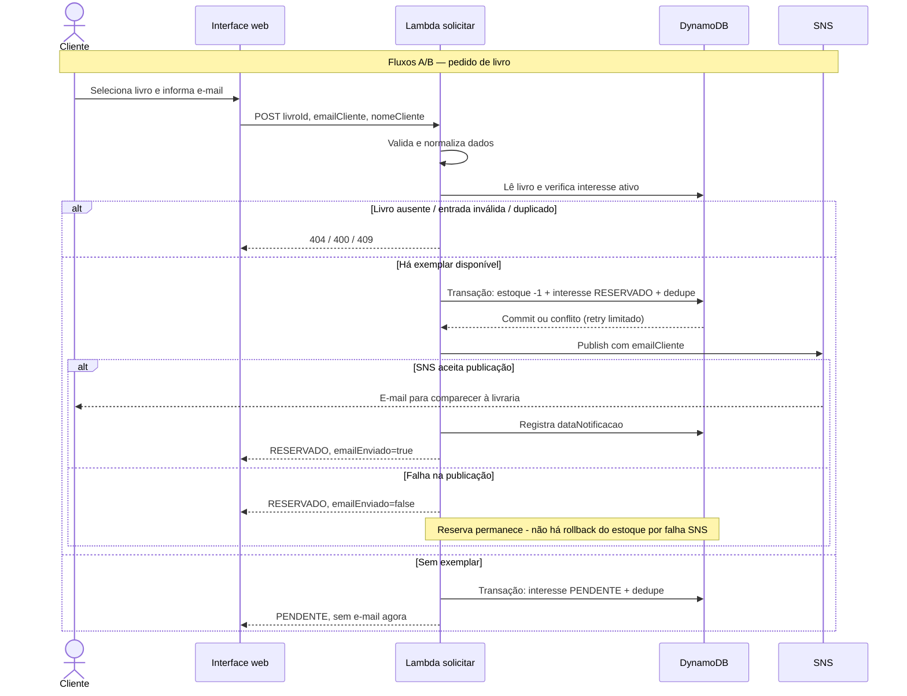
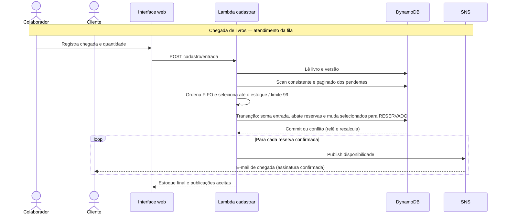
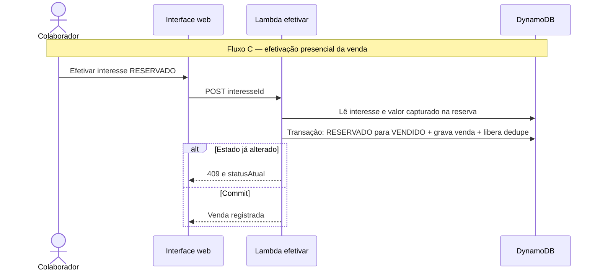

# Diagramas da aplicação

Os blocos Mermaid abaixo podem ser renderizados no GitHub, em um editor compatível ou no Mermaid Live Editor. As setas representam chamadas e dependências, não uma VPC: a solução não usa EC2, NAT ou RDS.

## Diagrama em blocos

## Diagrama UML de sequência

### Chegada e atendimento da fila

### Efetivação da venda

**Leitura importante:** `Publish` aceito não comprova entrega na caixa de entrada. O SNS depende de assinatura confirmada, filtro correspondente e processamento do provedor de e-mail. Os testes locais emulam os serviços; a entrega real precisa ser conferida na AWS e na caixa postal.
